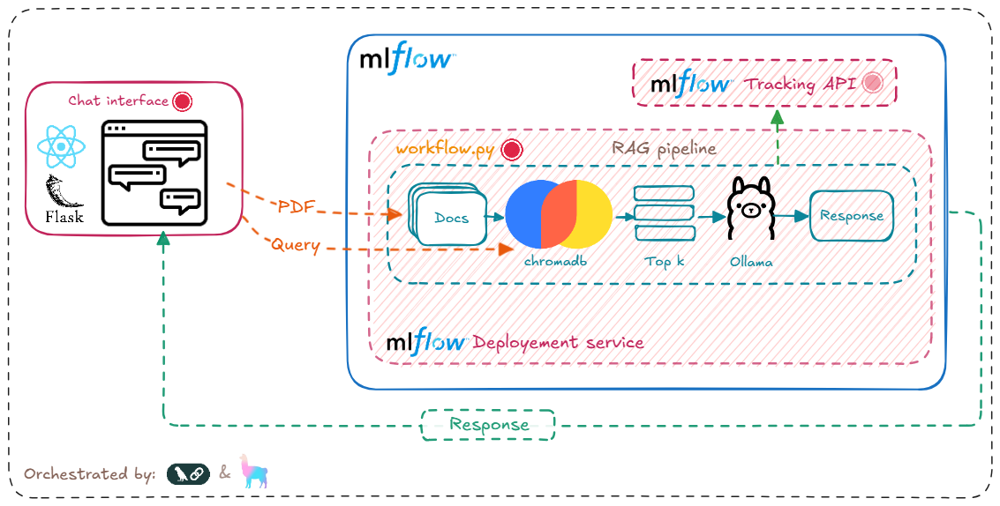
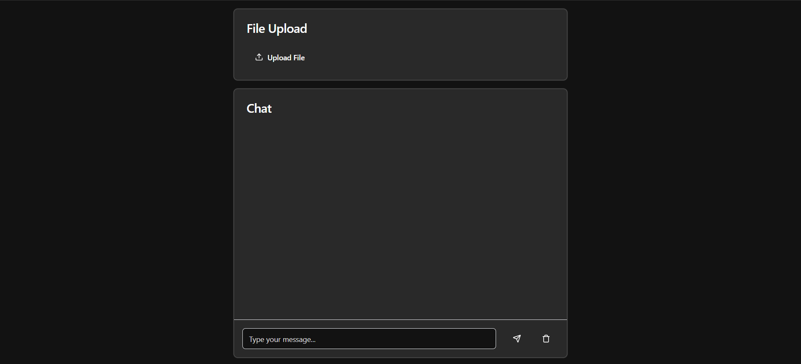

### MLflow Deployement of a RAG pipeline 🥀

This project is for people that want to deploy a RAG pipeline using MLflow.

The project uses:
- `LlamaIndex` and `langchain` as orchestrators
- `Ollama` and `HuggingfaceLLMs`
- `MLflow` as an MLOps framework for deploying and tracking
- `FastAPI` for the backend
- `React` for the frontend
- `Docker` and `Docker-compose` for containerization



### How to start

1. Clone the repository
```bash
git clone https://github.com/AnasAber/RAG_in_CPU.git
```

2. Install the dependencies
```bash
pip install -r requirements.txt
```
Make sure to put your api_keys into the `example.env`, and rename it to `.env`


3. Notebook Prep:
- Put your own data files in the data/ folder
- Go to the notebook, and replace "api_key_here" with your huggingface_api_key
- If you have GPU, you're fine just run the notebook. If not, run it on google colab, and make sure to download the json file output at the end of the run.

4. Go to `deployement` folder, and open two terminals:
```bash
python workflow.py
```
And after the run, paste the run ID showing in the terminal, and execute the following command:
```bash
mlflow models serve -m runs:/<run ID>/rag_deployement -p 5001
```
In the other terminal, make sure to run
```bash
python app.py
```
5. Open another terminal, and move to the `frontend` folder, and run:
```bash
npm start
```

Now, you should be seeing a web interface, and the two terminals are running.


If you got errors, try to see what's missing in the requirements.txt, nd check if all containers are running.

Enjoy!